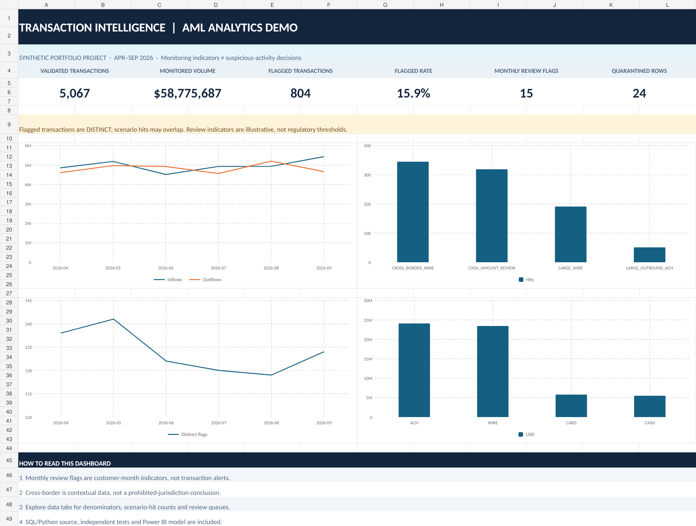

# Synthetic AML Transaction Intelligence

**SQL · Python · Excel dashboard · Power BI-ready model** — a reproducible portfolio demonstration of transaction-data validation, AML-oriented review indicators, and executive reporting.

> **100% SYNTHETIC DATA.** All customers, payments, expected volumes, risks, exceptions and rules are fabricated. No bank, customer, case, SAR, employer or Project Insight assets are included. Scenario hits are *not* suspicious-activity conclusions or regulatory thresholds.



## At a glance

| Measure | Result |
|---|---:|
| Fictional customer entities | 140 |
| Raw rows | 5,091 |
| Data-quality rejects | 24 |
| Validated transactions | 5,067 |
| Transaction volume (absolute magnitude) | $58,775,686.58 |
| Distinct transactions meeting ≥1 demo rule | 804 (15.87%) |
| Transaction-level rule hits | 906 |
| Customer-month review indicators | 15 |

## What this demonstrates

- **SQL:** normalized SQLite model, reproducible scenario logic, customer/month aggregation and validation queries.
- **Python:** seeded synthetic data generator, row-level quality quarantine, currency-safe processing, CSV/SQLite exports, exact reconciliations and eight independent tests.
- **Excel:** [`AML_Executive_Dashboard.xlsx`](AML_Executive_Dashboard.xlsx), including live formula KPI cards, four native charts and scenario / channel / segment / review-queue tabs.
- **Power BI:** [model import CSVs](powerbi/model/), [DAX measures](powerbi/MEASURES.dax), [theme](powerbi/theme.json) and a [step-by-step build guide](docs/POWER_BI_BUILD.md). *A native `.pbix` is not included.*
- **Browser preview:** [`dashboard/index.html`](dashboard/index.html) is a zero-dependency, offline interactive view with month/segment/risk filters and transaction-detail inspection.

## Reproduce the full data pipeline

Only Python 3.11+ and standard library are required for SQL/CSV processing and tests. Start from the repository root:

```bash
python scripts/generate_synthetic_data.py
python scripts/run_analysis.py
python scripts/build_html_dashboard.py
python -m unittest discover -s tests -v
```

The scripts write raw CSVs, clean transactions, detailed review indicators, auditable KPI aggregates, a queryable SQLite database and portable Power BI model CSVs. Re-run the generator to reproduce the same fictional sample (seed `20261024`).

## Why distinct counts matter

A payment can trigger two illustrative scenarios, such as a large wire that is also cross-border. Therefore **906 scenario hits ≠ 804 flagged transactions**. The dashboard and tests enforce the correct transaction grain. Customer-month indicators are measured separately and cannot be added to transaction hit counts.

## Explore the project

| Location | Contents |
|---|---|
| `scripts/` | Generator and auditable ETL / SQL-runner |
| `sql/` | Relational schema, scenario SQL, validation SQL |
| `data/raw/` | Fully fabricated inputs, including deliberately invalid records |
| `data/processed/` | Clean CSVs, quarantine, KPI marts, SQLite, JSON summary |
| `AML_Executive_Dashboard.xlsx` | Ready-to-open Excel report with native charts and formulas |
| `dashboard/` | Offline interactive HTML analytics preview |
| `powerbi/` | Power BI Desktop imports, DAX measures and theme |
| `tests/` | Eight independent tests |
| `docs/` | Data dictionary, rules and denominators, BI guide, validation, usage/privacy |

## Portfolio access

This repository is the public, independently created **synthetic AML transaction-analysis portfolio**. Explore the Excel dashboard above, review the reproducible SQL/Python pipeline, or open the offline HTML dashboard from `dashboard/index.html`. The repository does not contain private Project Insight materials.

The included Power BI files are a **ready-to-import model, DAX measures and build guide**, not a native `.pbix` report.

## Professional and regulatory boundary

This *illustrative analytics project* does not apply real bank thresholds, decide whether conduct is suspicious, rate individual customers as criminals, file SARs, or make sanctions decisions. FFIEC guidance differentiates monitoring alerts, alert management and subsequent SAR decisions; see [FFIEC BSA/AML Examination Manual — Suspicious Activity Reporting](https://bsaaml.ffiec.gov/manual/AssessingComplianceWithBSARegulatoryRequirements/04).

**Portfolio note:** This is a fictional demonstration, not an employer work product. Review the code, methodology and results before presenting or discussing the implementation. [Portfolio usage guidance](docs/PORTFOLIO_USAGE.md).
